# Hey, I'm Mayar! 🎀

<p align="center">
  
</p>

<p align="center">
  
</p>

<p align="center">
  <i>Welcome to my little corner of the internet.</i><br/>
  <i>There is code, curiosity, and probably a bug somewhere.</i>
</p>

---

##  A Little About Me

<table>
<tr>
<td width="65%" valign="middle">

- 🎓 CS Graduate from **Assiut University**.
- 🌸 ITI Game Programming Track: **Intake 47**.
- 💻 Interested in backend development and building applications.
- 🎮 Exploring game programming, C++, and Unity.
- 🧩 I love understanding how things work, not just making them work.
- 🌱 Always learning, experimenting, and building.

</td>
<td width="35%" align="center" valign="middle">


</td>
</tr>
</table>

---

##  My Two Development Worlds

<table>
<p align="center">
<tr>
<td width="50%" valign="top">

### Behind the Scenes

**Backend Development**

The logic and systems that make applications work.

- RESTful APIs with ASP.NET Core.
- Databases and SQL.
- OOP and design patterns.
- Layered architecture.
- Authentication and authorization.

<p align="center">
  
  
  
</p>

</td>
<td width="50%" valign="top">

### Into Another World

**Game Development**

Where programming meets creativity and imagination.

- C++ and game programming fundamentals.
- Unity and C#.
- Game objects and transformations.
- Vectors, movement, and collision detection.
- Game mechanics and object-oriented design.

<p align="center">
  
  
  
</p>

</td>
</tr>
</p>
</table>

---

##  My Technical Toolbox

<div align="center">

### 💻 Programming Languages


### ⚙️ Frameworks & Development


### 🗄️ Databases


### 🛠️ Tools & Platforms


### 🎨 Other Tools & Interests


</div>

---

##  Things I've Built

<table>
<tr>
<td valign="top">

### 🎓 ScholaAI: Graduation Project

An AI-powered learning platform connecting students and tutors through personalized learning experiences.

**My contribution:** Backend development with ASP.NET Core Web API, user management, session functionality, and application architecture.

`C#` `ASP.NET Core` `SQL Server` `React` `TypeScript`

<p align="center">
  <a href="https://github.com/hanasoliman72/ScholaAi">
    
  </a>
</p>

</td>
</tr>
</table>

---

##  A Developer's Daily Routine

```cpp
// Developer.exe has stopped working...
while (alive) {
    try {
        have_an_idea();
        open_visual_studio();
        write_some_code();
        run_program();
    }
    catch (Bug bug) {
        google(bug);
        understand(bug);
        fix(bug);
        accidentally_create_another_bug();
    }

    cout << "BUG BUG BUG BUG BUG..." << endl;
    repeat();
    // TODO: fix everything
    // TODO: understand what happened
    // TODO: get some sleep
}
```

<p align="center">
  
</p>

<p align="center">
  <i>Works on my machine. Until it doesn't.</i>
</p>

*It's called character development. Probably.*

---

##  Let's connect!

Always happy to meet fellow developers, exchange ideas, collaborate, and discover interesting projects.

<p align="center">
  <a href="https://www.linkedin.com/in/mayar-elsawaf-5701b4333/" target="_blank">
    
  </a>
  <a href="mailto:mayarsawaf@gmail.com">
    
  </a>
</p>

<p align="center">
  <i>"Stay curious. Keep building. And never stop asking why."</i> ✨
</p>

---

##  A little arcade break

<p align="center">
  
</p>

<p align="center">
  <i>Apparently, even my contributions need a little gaming break.</i> 🚀
</p>

---

<p align="center">
  Thanks for stopping by! Hope you found something interesting here. ♡
</p>
